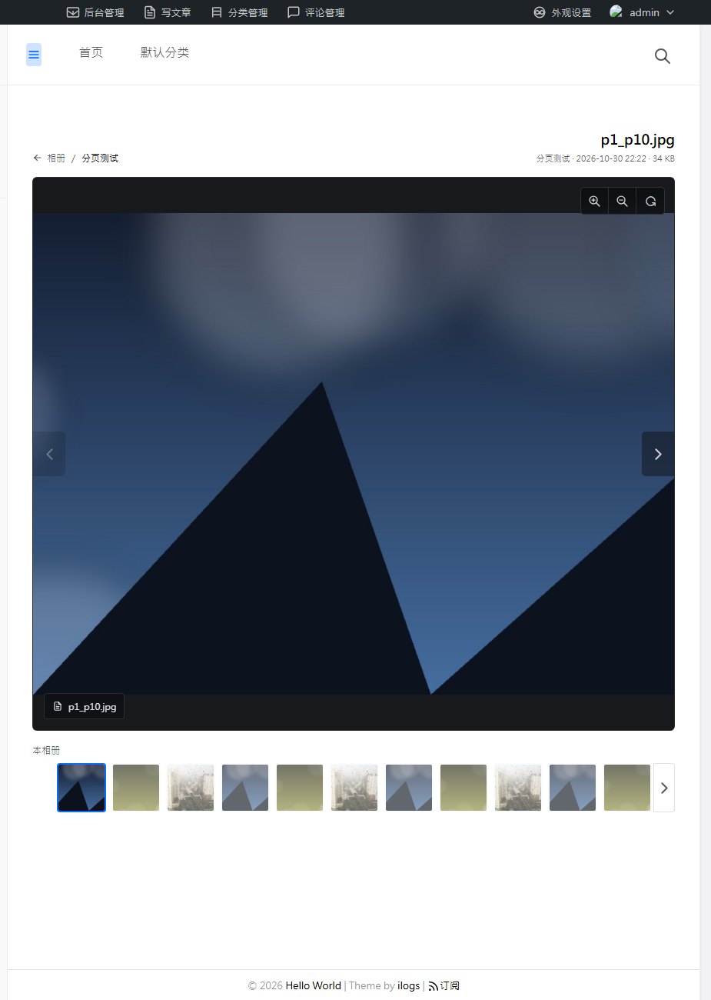

# IlGallery · 图库相册

为 Typecho + [ilogs](https://ilogs.cn) 主题打造的相册插件。后台可创建多个相册、批量上传照片、设定封面与排序；前台以相册墙 → 照片墙 → 沉浸式大图查看器三级结构展示，视觉风格与 ilogs 官方图库保持一致。


---

## 效果预览

### 前台

| 相册墙 | 照片墙 |
| --- | --- |
| 相册墙 | 照片墙 |

大图查看器：同一页展开，支持缩放、左右切换、键盘操作、底部缩略图条，可跨页连续浏览。



### 后台

| 相册列表 | 照片管理 |
| ---- | ---- |
| 相册列表 | 照片管理 |

---

## 功能特性

**后台管理**

- 多相册管理：新建 / 编辑 / 删除，支持标题、别名、描述、排序、状态
- 批量上传：一次拖拽多张，实时进度条，单张上限可配置
- 封面设定：自动取第一张，也可手动指定任意一张
- 拖拽排序：照片顺序所见即所得
- 即时重命名：双击照片标题直接改
- 一键修复：承载页面丢失、路由失效时可一键重建（面板上的「修复页面与路由」）

**前台展示**

- 相册墙：响应式网格，桌面端 2 / 3 / 4 列可选，封面 4:3 裁切
- 照片墙：方形缩略图，桌面端 4–8 列可选，默认 6 列，每页 24 张并带分页
- 大图查看器：沉浸式暗色舞台，支持放大 / 缩小 / 复位、左右切换、下载（可关）、底部缩略图条、跨页连续浏览
- 键盘快捷键：`←` `→` 切换，`+` `-` 缩放，`0` 复位，`Esc` 关闭

**技术细节**

- 上传时自动按 EXIF 校正照片方向，手机竖拍不会躺倒
- 自动生成最长边 960px 的缩略图，列表页不拖慢加载
- 图片统一存到 `usr/uploads/ilgallery/年/月/`，删除相册时连带清理文件
- 兼容 SQLite 与 MySQL
- 前台资源与数据都放在 PJAX 刷新区内，主题开启 PJAX 也能正常工作
- 所有图标为内联 SVG，不依赖 tabler-icons

---

## 环境要求

| 项目      | 要求                                       |
| ------- | ---------------------------------------- |
| Typecho | 1.2.0 及以上（已在 **1.2.1** 与 **1.3.0** 实测通过） |
| PHP     | 7.4 及以上（Typecho 1.3.0 自身要求 PHP 8.0+）     |
| 扩展      | PDO（SQLite / MySQL）、**GD**（缩略图与方向校正，必需）  |

> 插件在 Typecho 1.2.x 与 1.3.x 上均做过布局验证。1.3.0 的后台内容容器是 flex 布局，插件已自带宽度约束，不受影响。

---

## 安装

1. 下载本仓库，或克隆：
   ```bash
   git clone https://github.com/xiguacaizimi/IlGallery.git
   ```
2. 把仓库里的 **`IlGallery`** 目录整个上传到站点的 `usr/plugins/` 下，路径应为：
   ```
   usr/plugins/IlGallery/Plugin.php
   ```
3. 进入后台 **控制台 → 插件**，找到「图库相册」，点击**启用**。
4. 启用后左侧菜单会出现「图库」，点进去即可开始创建相册。

---

## 快速开始

1. 后台 **图库 → 新建相册**，填写标题、别名（前台 URL 用）、描述。
2. 进入相册，把照片拖进上传区（或点击选择文件），等待进度条走完。
3. 拖拽调整顺序，点「设为封面」指定封面，双击标题可重命名。
4. 访问 `https://你的域名/gallery/` 查看相册墙。

前台地址规则：

| 页面   | 地址                              |
| ---- | ------------------------------- |
| 相册墙  | `/gallery/`                     |
| 单个相册 | `/gallery/{相册别名}/`              |
| 某张照片 | `/gallery/{相册别名}/?photo={照片ID}` |

插件启用时会自动创建一个别名为 `gallery` 的页面来承载图库，因此主题导航里直接指向该页面也能正常显示图库，无需任何模板改动。

---

## 配置项

后台 **插件 → 图库相册 → 设置**：

| 配置项     | 默认值         | 说明                                                          |
| ------- | ----------- | ----------------------------------------------------------- |
| 图库页标题   | 相册          | 相册墙顶部的大标题                                                   |
| 图库页副标题  | 收藏日常片段与文章影像 | 标题下方的灰色说明文字                                                 |
| 相册墙列数   | 3           | 桌面端相册卡片列数，可选 2 / 3 / 4                                      |
| 照片墙列数   | 6           | 相册详情页列数，可选 4–8                                              |
| 单张上传上限  | 20（MB）      | 受服务器 `upload_max_filesize` 与 `post_max_size` 限制，超出时以服务器配置为准 |
| 查看器下载按钮 | 不允许         | 是否在大图查看器中显示下载按钮                                             |

---

## 目录结构

```
IlGallery/
├── Plugin.php              # 激活/停用、菜单、路由、配置、页面钩子
├── Manage.php              # 后台面板（列表 / 编辑 / 照片管理 + AJAX）
├── Store.php               # 数据层（ilgallery_albums / ilgallery_images 两张表）
├── Image.php               # 上传、EXIF 方向校正、GD 缩略图
├── Renderer.php            # 前台公共渲染器（路由与页面钩子共用）
├── Widget/Gallery.php      # 继承 Widget\Archive 的前台路由 Widget
├── templates/gallery.php   # 前台模板（复用 ilogs 外壳）
└── assets/
    ├── gallery.css|js      # 前台样式与交互
    └── admin.css|js        # 后台样式与交互
```

---

## 常见问题

**前台 `/gallery/` 打不开或 404**

先确认插件已启用，再进后台 **图库** 面板点一次「修复页面与路由」——它会重建承载页面、重写配置并重注册路由。若仍不行，检查站点是否开启了「地址重写」功能：没有重写时，地址需要带 `index.php`，即 `/index.php/gallery/`。

**上传时提示失败或图片不显示**

多半是 GD 扩展未安装，或 `usr/uploads/` 目录不可写。给目录设置可写权限，并在 `php.ini` 中适当调大 `upload_max_filesize` 与 `post_max_size`。

**照片躺着/方向不对**

插件会按 EXIF 的 Orientation 自动校正。若服务器未安装 EXIF 扩展，会跳过校正，此时建议在上传前用图片工具把方向转正。

**与主题的样式冲突**

插件的图片容器统一用 `padding` 撑出比例、图片绝对定位铺满（`object-fit: cover`），并带 `!important`，可以抵抗大部分主题对 `img` 的全局重置。

---

## 更新日志

详见 [CHANGELOG.md](./CHANGELOG.md)。

---

## 许可证

[MIT License](./LICENSE) © 2026 xiguacaizimi

---

## 作者

**xiguacaizimi**

- 主页：<https://www.xiguacaizimi.top>
- 邮箱：<xiguacaizimi@163.com>

欢迎 Issue 与 Pull Request。如果插件对你有帮助，给仓库点个 Star 就是最大的支持。
